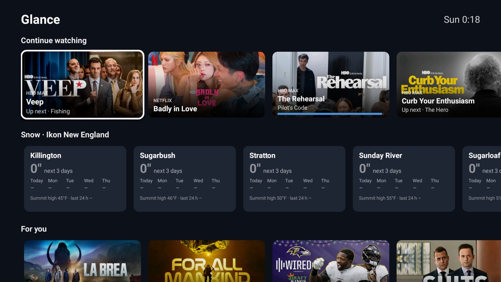

# Glance

One page for the sofa: **Continue watching** from your streaming apps, **snow at the New England Ikon Pass
mountains**, **Now playing** while music plays, and **For you** picks from your apps. For the
[Clean Your TV](../../README.md) launcher it declares a [module card](../../docs/modules.md), so once you
answer **Show card** its tile reads "Glance"; on any other Android TV home it is an ordinary app.



- **Continue watching** comes from the apps' own Watch Next rows in the TV provider
  ([docs/watch-next.md](../../docs/watch-next.md)): most recently watched first, one card per show, with a
  progress bar when the app says how far in you are. OK opens the app at that episode; the deep link is kept to
  the app that published it, falling back to the app's start screen. On the TV it was tested on, Disney+,
  Peacock, Max, Netflix, Hulu and Paramount+ publish rows; YouTube does not.
- **Snow** is Open-Meteo's daily snowfall (no key) at each summit's elevation for Killington, Sugarbush,
  Stratton, Sunday River, Sugarloaf and Loon: the next three days in big type, then each day, the summit high and
  the last 24 hours. Mountains with the most snow coming sort first, and a card turns blue when 6″ or more is on
  the way. Read at most once an hour, only while the page is on screen. Edit `Snow.NAMES` and `SUMMITS` to track
  other mountains.
- **Now playing** shows the playing (or paused) media session from any app, Spotify included, with its art.
  OK opens the player.
- **For you** takes the apps' preview rows in turn (YouTube, Prime Video, Apple TV, Netflix…), so no one app
  fills the row.
- Nothing runs in the background. Rows are read when the page comes on screen. The notification listener exists
  only because Android hands media sessions to listeners; it ignores every notification.
- A debug screen lists everything the TV shares: `am start -n com.teddy.glance/.ProbeActivity`, then
  `logcat -s GlanceProbe`.

## Permissions

| Permission | Why |
|---|---|
| `INTERNET` | Posters from the apps' image servers, and the snow forecast from Open-Meteo. |
| `READ_TV_LISTINGS` | Other apps' Continue watching and preview rows. A runtime permission: grant it with `pm grant com.teddy.glance android.permission.READ_TV_LISTINGS`. |
| Defines `com.teddy.glance.permission.READ_ROWS` (signature) | Guards the provider (`content://com.teddy.glance.rows/home`) and `OpenActivity`, which feed the launcher's `glance_row`. Only a launcher signed with the same key can read your watch history or open cards through it. |
| Notification access (`BIND_NOTIFICATION_LISTENER_SERVICE`) | Lets the app read active media sessions for Now playing. It technically allows reading every notification; this app reads none. Grant with `cmd notification allow_listener com.teddy.glance/.MediaListener`, remove with `disallow_listener`. |

What is sent: the six mountains' coordinates to Open-Meteo, and poster requests to the apps' own image servers.
No account, no telemetry, no ads, no background service.

## Build and install

JDK 17 and Android SDK platform 34 with build-tools 34.0.0, as for the launcher:

```bash
cd addons/glance && ./gradlew assembleRelease
TV_HOST=<tv ip> ../../tools/venv/bin/python -I ../../tools/tv.py --push app/build/outputs/apk/release/app-release.apk /data/local/tmp/addon.apk
TV_HOST=<tv ip> ../../tools/venv/bin/python -I ../../tools/tv.py 'pm install -r /data/local/tmp/addon.apk; rm -f /data/local/tmp/addon.apk'
TV_HOST=<tv ip> ../../tools/venv/bin/python -I ../../tools/tv.py 'pm grant com.teddy.glance android.permission.READ_TV_LISTINGS; cmd notification allow_listener com.teddy.glance/.MediaListener'
```

Press Home: the launcher asks once whether to show the card.

## Tested on

TCL Smart TV Pro (BeyondTV4), Google TV 11.
