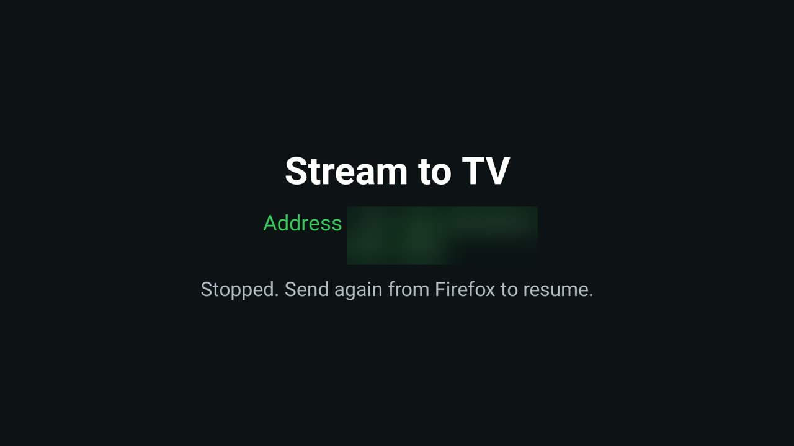

# Stream to TV

Plays the live stream you are watching in Firefox on the laptop on the TV instead, and keeps it playing. It sends
the stream, not the screen: the TV fetches the site's HLS playlist (`.m3u8`) itself and decodes it in hardware,
so the picture is as sharp and smooth as the stream, with none of screen mirroring's lag. It has two parts:

- **The TV app** (`app/`), a full-screen player (Media3) that listens on the home network for the laptop while
  its screen is open, and only then.
- **A Firefox add-on** (`firefox/`) with a toolbar button. It lists the streams the current tab has loaded, sends
  one to the TV, and from then on passes the TV each renewed stream token the page gets.

That last part is why this works on sites where copying the `.m3u8` link does not: many sites put a token in the
playlist and segment URLs that expires after a few minutes (30 on the site this was built for), and the page
quietly fetches a new one. The add-on sees each new playlist URL, and the TV swaps the renewed values into its
next requests to that host, so playback carries on across renewals.

For the [Clean Your TV](../../README.md) launcher it declares a [module card](../../docs/modules.md): once you
answer **Show card** its tile reads "Stream to TV" with a green glow. On any other Android TV home it is an
ordinary app.



## Use it

1. Open **Stream to TV** on the TV. It shows its address and a PIN.
2. In Firefox, open the add-on's **Settings** (toolbar button, then Settings), enter both and press **Save and
   test**.
3. Start the video on the page. The toolbar button shows how many streams the tab has loaded.
4. Press the button, then **Send to TV** next to the stream. The top row is usually the one: playlists the page
   is still fetching are listed first, and the add-on sends the newest token the page has. The badge turns to
   **TV** while that tab feeds the TV.
5. Keep the tab open: it is what gets the renewed tokens. **Stop on TV** in the popup, or Back on the remote,
   stops playback.

## Permissions

The TV app:

| Permission | Why |
|---|---|
| `INTERNET` | To fetch the stream, and to listen on port 8642 for the laptop while the screen is open. |

Cleartext HTTP is allowed because many stream hosts and the laptop link use it. The server starts when the screen
opens and stops when it closes: no background service, no start at boot. It answers only requests that carry the
PIN; a request from a web page (by its `Origin`) or one that is not `application/json` is refused, there are no
CORS headers, and five wrong PINs in a row lock the PIN out for a minute, doubling each time up to an hour. Without
the PIN, `/status` says only whether something is playing.

The Firefox add-on:

| Permission | Why |
|---|---|
| `webRequest` | To see the tab's playlist requests (`.m3u8`), with the User-Agent, Referer and Origin they carry. |
| `<all_urls>` | Streams can come from any host, and the add-on talks to the TV on your home network. |
| `tabs` | The current tab, to list its streams and send its title. |
| `storage` | The TV's address and PIN. |

The add-on sends the TV only the playlist URL, those three headers and the tab's title; never cookies. Nothing
goes anywhere but your TV. No telemetry, ads or accounts in either part.

## Build and install

**The TV app.** JDK 17 and Android SDK platform 34 with build-tools 34.0.0, as for the launcher. From the repo
root, with ADB on:

```bash
TV_HOST=<tv ip> addons/stream-to-tv/install.sh
```

To build only: `cd addons/stream-to-tv && ./gradlew assembleRelease`. The JVM tests (`TokenRewriter`) run with
`./gradlew testReleaseUnitTest`.

**The Firefox add-on.** In Firefox, open `about:debugging#/runtime/this-firefox`, press **Load Temporary
Add-on…** and pick `addons/stream-to-tv/firefox/manifest.json`. A temporary add-on is gone when Firefox
restarts. To keep it, sign it for yourself as an unlisted add-on with a free addons.mozilla.org API key
(`npx web-ext sign --channel=unlisted --source-dir addons/stream-to-tv/firefox`) and install the `.xpi` it makes.

On macOS, Firefox can't reach the TV until **System Settings → Privacy & Security → Local Network** allows
Firefox. A VPN on the laptop must let LAN traffic through (in Windscribe, **Allow LAN Traffic**).

## Limits

- **HLS only.** A stream the page plays from an `.m3u8` playlist. Sites that use DASH, or DRM (Netflix, Disney+
  and the like), are not for this app.
- **The tab feeds the renewals.** Close it, or let the page stop renewing, and the TV plays until the last token
  expires. The TV then waits for a fresh one and picks up again when the add-on sends it.
- **Tokens tied to cookies or to the laptop's IP address** don't work, because the TV sends neither the cookies
  nor the laptop's IP.
- **One stream at a time.** Sending another replaces it.

## Tested on

TCL Smart TV Pro (BeyondTV4), Google TV 11, with Firefox 158 on macOS:

- A live sports page with 30-minute tokens on the playlist and every segment: played on the TV's hardware
  decoder, and kept playing across a renewal.
- A test site with 2-minute tokens, a master and a media playlist and a cache-buster on every poll: 34 minutes and
  21 renewals with no rebuffering and no refused request. With the page renewing 20 s after expiry, the TV
  picked up each new token within 0.1 s of the page getting it, so it was down only as long as the page had no
  valid token.
- LiveNOW from FOX, whose playlists come through an ad-inserting proxy with no `.m3u8` in the path.

The screenshot is the TV app's own screen, with the address and PIN blurred; the video itself does not show in a
TV screenshot. The JVM tests cover the token rewriting.

## Maintainer

[@trobb20](https://github.com/trobb20)
